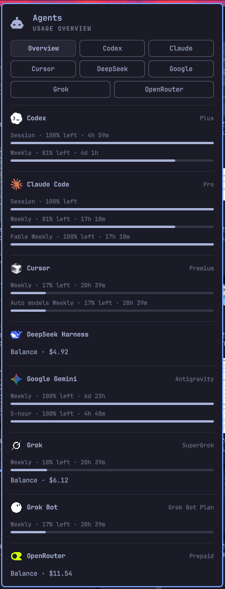

# Omarchy Agent One

Usage dashboard for coding agents in Omarchy. It extends the Omarchy Agents panel with provider-specific usage and account limits where those can be read reliably.

**Plugin ID:** `calmasacow.agent-one`  
**Repository:** `omarchy-agent-one`  
**Author:** James Barnette  
**License:** MIT



## Supported agent roadmap

Overview is always the first button and the default whenever the panel opens. It lists every tracked provider with account limits, reset countdowns, balances, or local token counts where available. Click a row to open its provider page.

The selector retains these nine agent IDs and labels, plus the requested OpenRouter account:

1. `codex` — Codex
2. `claude` — Claude
3. `grok` — Grok
4. `google` — Google (Gemini / Antigravity CLI)
5. `cursor` — Cursor
6. `deepseek` — DeepSeek
7. `opencode` — OpenCode
8. `pi` — Pi
9. `qwen` — Qwen Code
10. `openrouter` — OpenRouter

The existing Codex, Claude, and Grok usage panels are carried forward. Google Gemini support uses the installed Antigravity CLI (`agy`): token and prompt totals come from local transcript counters, while remaining Gemini weekly and five-hour quota comes from `agy /usage`. The collector reads timestamps and numeric counters only; prompt and response content is discarded. Quota is cached for five minutes. DeepSeek Harness contributes all-time local token and turn totals from its session usage projections. The collector reads aggregate counters only, never prompt text. Today's totals include sessions created today; the projections do not timestamp turns in older sessions, so their usage cannot be split by day. DeepSeek's balance is queried every five minutes through the credential route selected by the active Harness model configuration: the Harness OAuth grant uses DeepSeek Platform's account summary, and an API-key route uses DeepSeek's documented `/user/balance` endpoint. Credentials stay local and are never written to usage records or synced snapshots. Local token totals remain separate from account balance.

The provider selector balances rows with at most three buttons each. Four providers use two rows of two; seven use rows of three, two, and two; eight use rows of three, three, and two.

## OpenRouter and Grok Bot

OpenRouter support folds in [OpenRouter Usage Plus](https://github.com/calmasacow/omarchy-openrouter-usage-plus), based on upstream commit `78f37a588b93a4de11a57f8d95cdf24ebd1d8526` (MIT; attribution in `assets/OPENROUTER-LICENSE`). It reuses your existing `~/.config/omarchy/agents/openrouter.json` configuration (`apiKey`, optional `managementKey`, optional `fundedAmount`) or `OPENROUTER_API_KEY` / `OPENROUTER_MANAGEMENT_KEY`. Config files must be mode `600`. No credentials are copied into this project.

The collector polls OpenRouter's fixed HTTPS API every five minutes and on refresh; disable `providers.openrouter.enabled` to stop polling. It shows authoritative prepaid credits, key limits, monthly account analytics (optional management key), ranked models/apps/keys, and seven-day local pi/omp rated spend. Without analytics, activity totals cover the seven local days; model rankings use scanned local history. Local app usage remains separate from account billing. Balances, account analytics, and quotas are never summed across synced devices. Failed refreshes preserve the previous valid figures. OpenRouter appears after a usable account or local usage is found; the standalone plugin can remain installed independently.

Grok Bot uses Omarchy's installed `omarchy-agent-usage-grokbot` collector: its separate weekly allowance comes from Cursor's `GetSandUsageStatus` RPC using the existing Cursor sign-in. Its branded icon and allowance appear within the Grok page and as a separate Overview row, without another selector button. No allowance or sign-in means no Grok Bot row. Disabling Grok also hides Grok Bot. A current Omarchy installation with this collector is required.

## Install

Requires a current Omarchy 4.x / Quattro installation (Quickshell and the stock agent usage collectors), Python 3, and Bash. Provider CLIs and their local sign-ins are needed only for the providers you use. Grok Bot additionally requires the stock Grok Bot collector and a Cursor sign-in; Google quota polling requires Antigravity (`agy`). No Python packages are required.

```sh
omarchy plugin add https://github.com/calmasacow/omarchy-agent-one.git --enable
```

OpenRouter configuration is optional; see above. Provider collectors read existing local histories and credentials without changing them. Usage records are stored under `${XDG_STATE_HOME:-~/.local/state}/omarchy/agents/usage`; collector caches use `${XDG_CACHE_HOME:-~/.cache}/omarchy/agent-usage`. Account quota refreshes contact the enabled providers' APIs. Optional synchronized snapshots include aggregate local statistics, never credentials, account balances, or quotas.

Cursor uses the installed Omarchy collector. OpenCode, Pi, and Qwen selectors accept compatible local or synchronized usage records; dedicated bundled collectors for these apps remain on the roadmap. Providers appear only when there is data to display.

## Remove

```sh
omarchy plugin remove calmasacow.agent-one
```

Provider histories, sign-ins, OpenRouter configuration, shared agent usage records, and shared collector caches remain untouched. Other Omarchy agent widgets may still use them.

## Usage

| Control | Action |
|---|---|
| Left-click | Open or close the usage panel |
| Right-click | Launch the default coding agent |
| Middle-click | Next agent |
| `h` / `l` | Switch agent |
| `r` or Enter | Refresh |
| Esc | Close |

## Development

Run the existing collector and panel checks with `test/run` when requested. The shared helper bounds local file reads and handles usage-record discovery; provider-specific collectors write JSON records to Omarchy's standard agents usage directory.

## License

MIT. Panel QML is adapted from Omarchy's first-party Agents plugin.
